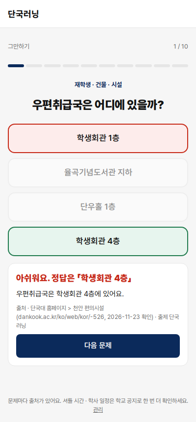

# 단국러닝 — 나는 천캠 고인물일까?

단국대 천안캠퍼스를 **10문제 퀴즈**로 알아 가는 서비스예요.

<p align="center">
  
  
  
</p>

## 왜 만들었나요?

편입생이었던 저는 학식이 학생회관에만 있는 줄 알았어요. 알고 보니 치대에도 있었어요.
**아무도 알려 주지 않으면 모르는 학교 정보**를 퀴즈로 쉽게 알려 주고 싶었어요.

## 이렇게 써요

1. **신·편입생** 또는 **재학생** 버전을 골라요.
2. 10문제를 풀어요. 고르면 바로 정답과 해설이 나와요.
3. 결과 카드로 내 유형을 확인하고 친구에게 공유해요.

재학생 버전에서 **80점 이상**이면 「고인물」 인증! 내가 아는 꿀팁을 문제로 낼 수 있어요.

## 알아 두세요

- 문제는 학교 홈페이지 등 공식 자료로 확인한 내용이에요.
- 셔틀 시간 · 학사 일정은 학교 공지로 한 번 더 확인해 주세요.

만든 사람: 원종학 (공공정책학과 3학년) · 2026 천안 AX 액션러닝 개인 프로젝트

---
---

# 🛠 개발자용 안내

> 아래부터는 프로젝트를 실행하거나 고치는 사람을 위한 내용이에요.

## 실행

```bash
npm install
cp .env.example .env.local     # 아래 「설정」을 채운다
npm run serve -- --host ::     # http://localhost:3005  (관리 페이지: /admin)
```

- 공용 서버에서는 VS Code **포트 전달**(3005)로 접속한다. 보안상 이 컴퓨터(localhost) 밖에서 오는 접속은 막혀 있다 (`ALLOW_NETWORK=1`이면 허용).
- 확인: `npm run lint && npm run build`

## 설정 (`.env.local`)

| 이름 | 하는 일 | 없으면 |
| :-- | :-- | :-- |
| `ADMIN_PASSWORD` | 관리 페이지 비밀번호 | 관리 페이지 잠김 |
| `APP_SECRET` | 출제 자격 표 서명 (아무 긴 글자) | 서버를 다시 켤 때마다 자격 초기화 |
| `OPENROUTER_API_KEY` · `OPENROUTER_MODEL` | AI (문제 초안 · 1차 점검) | AI 초안만 안 되고 나머지는 동작 |
| `PORT` | 포트 (공용 서버는 계정별로 이미 있음) | 5173 |

`.env.local`은 git에 올라가지 않는다. 값을 채팅 · 문서 · 화면에 쓰지 않는다. 바꾼 뒤에는 서버를 다시 켠다.

## 관리 페이지 (`/admin`)

| 메뉴 | 하는 일 |
| :-- | :-- |
| 검수 대기 | 재학생 · AI · GPT가 낸 문제를 보고 **승인 / 고쳐서 승인 / 반려**. 규칙 점검(금지어 · 개인정보 · 비슷한 문제)과 AI 점검 결과가 같이 보인다 |
| AI 초안 만들기 | 학교 공식 안내문을 붙여 넣으면 AI가 **그 글만 근거로** 문제 초안을 만든다. 근거 문장이 안내문에 없으면 「확인 필요」 |
| 직접 추가 | 관리자가 확인한 문제를 바로 공개 |
| 전체 문제 | 공개 · 반려 목록, 삭제 |

## 문제 늘리기

- **직접 · AI:** 관리 페이지의 「직접 추가」 · 「AI 초안 만들기」
- **GPT로 모으기:** [docs/03_gpt_farming_prompt.md](docs/03_gpt_farming_prompt.md)를 ChatGPT(웹 검색 켜기)에 붙여 넣고, 답을 `docs/farm/gpt_날짜.md`로 저장한 뒤 서버를 끈 상태에서
  ```bash
  npm run import-questions -- docs/farm/gpt_날짜.md   # → 검수 대기로 들어감
  ```
- **처음 문제(seed):** `server/seed.js`. 켤 때 `data/questions.json`에 없는 것만 더해진다.

## 구조

```
src/
  App.jsx             퀴즈 화면: 시작 → 한 문제씩 → 결과 카드, 문제 내기
  AdminApp.jsx        관리 페이지
  QuestionForm.jsx    문제 입력 양식 (올리기 · 관리 공통)
  api.js              서버 호출 모음
  App.css · ui/ · tokens.css   디자인
server/
  index.js            API 주소 (routes)
  sessions.js         퀴즈 세션: 서버가 한 문제씩 채점 (정답을 화면에 미리 안 보냄)
  questions.js        규칙: 입력 확인 · 금지어 · 비슷한 문제 · 등급 · 출제 자격 표 · 올리기 제한
  store.js            저장: data/questions.json (DB 없음)
  seed.js             처음 문제 (출처 포함)
  admin.js            관리자 로그인
  llm/                AI 호출(client.js) · 지시문(prompts.js)
scripts/
  serve.mjs           실행기 (다시 켜기 지원)
  import-questions.mjs  GPT 파일 → 검수 대기
vite.config.js        화면 + API를 한 포트로, 보안 입구(접속 제한 · 파일 차단 · 헤더)
docs/                 기획(PRD) · 벤치마킹 · GPT 지시문 · 할 일 · 화면 캡처
```

## API

| 주소 | 설명 |
| :-- | :-- |
| `GET /api/health` | AI · 관리자 설정 · 공개 문제 수 |
| `GET /api/meta` | 난이도 · 분야 이름, 문제 수 |
| `GET /api/recent` | 최근 공개된 문제 5개 (제목만) |
| `GET /api/quiz?level=newbie\|senior` | 퀴즈 10문제 + 세션 (정답 · 해설은 안 보냄) |
| `POST /api/answer` | 한 문제 채점 (첫 답만 기록) → 정답 · 해설 · 출처 |
| `POST /api/qualify` | 세션 기록으로 판정, 재학생 80점 이상이면 출제 자격 표 (7일) |
| `POST /api/questions` | 문제 올리기 (출제 자격 필요, 1시간 5개) → 검수 대기 |
| `POST /api/admin/login` | 관리자 로그인 (주소별 5회 틀리면 1분 잠금) |
| `GET · POST · DELETE /api/admin/questions` | 문제 목록 · 직접 추가 · 삭제 |
| `POST /api/admin/review` | 승인 · 고쳐서 승인 · 반려 |
| `POST /api/admin/draft` | 안내문 → AI 문제 초안 |
| `POST /api/restart` | `.env.local` 다시 읽기 (관리자, `npm run serve`일 때) |

## 보안 요약

- 정답은 서버에만 두고 한 문제씩 채점 → 개발자 도구로 정답을 볼 수 없다
- `data/` · `server/` · 문서 · 설정 파일은 주소로 열 수 없다, `.env.local` 권한 600
- 출제 자격 표는 서버 서명 + 7일, 문제 올리기 횟수 제한, 보안 헤더
- 자세한 규칙: [CLAUDE.md](CLAUDE.md) 「보안」

## 문서

| 문서 | 내용 |
| :-- | :-- |
| [docs/01_prd.md](docs/01_prd.md) | 기획서 (한 단락 PRD · 6질문) |
| [docs/02_benchmarking.md](docs/02_benchmarking.md) | 비슷한 서비스 비교 · 차별점 · 문제 출처 |
| [docs/03_gpt_farming_prompt.md](docs/03_gpt_farming_prompt.md) | GPT 문제 조사 지시문 |
| [docs/07_todo.md](docs/07_todo.md) | 일정 · 할 일 |

기술: React 19 · Vite 8 · Node.js 22 · OpenRouter AI
